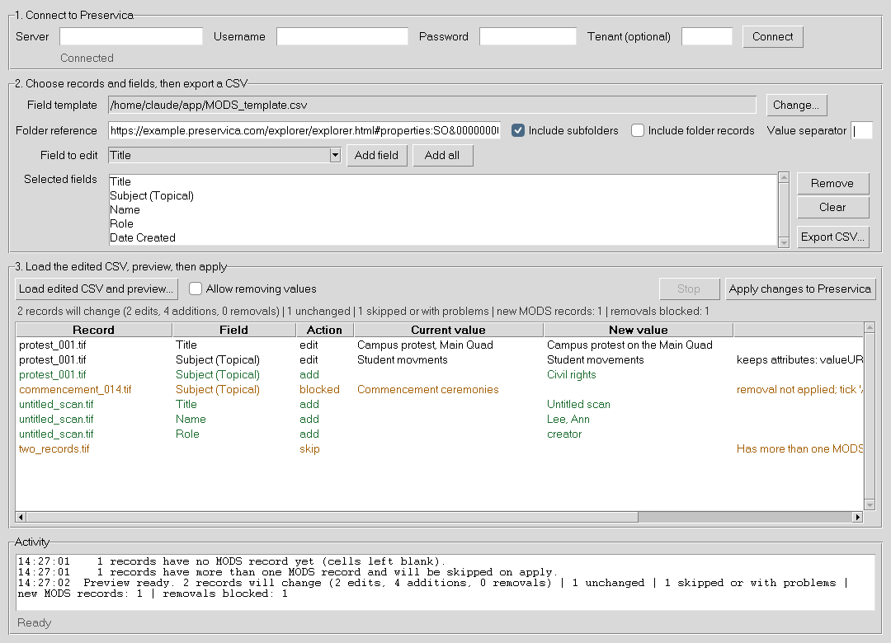

# PreservicaMetadataEditor

**Preservica MODS Batch Editor**

A small desktop tool for batch-editing MODS metadata in Preservica, with OpenRefine (or any spreadsheet tool) as the editing step.



> **Status:** tested against sample MODS records with a stand-in for the Preservica connection. Run it on a small test folder before using it on real collections.

## Setup (once)

1. Install Python 3.10 or newer from python.org. On Windows, tick "Add Python to PATH". On Linux you may also need the `python3-tk` package.
2. Download this repository, open a terminal in its folder and install the two libraries:

   ```
   pip install -r requirements.txt
   ```

3. Start the tool:

   ```
   python preservica_mods_editor.py
   ```

## Using it

1. **Connect.** Enter your server (for example `us.preservica.com`), username and password. The password is never saved. If your account uses single sign-on or two-factor login, ask your Preservica administrator for a local API account, or leave the boxes empty and use a pyPreservica `credentials.properties` file.
2. **Export.** Paste the folder's reference (or its Preservica URL), pick fields from the dropdown with **Add field**, then **Export CSV**.
3. **Edit.** Open the CSV in OpenRefine. Multiple values in one cell are separated by `|`. In OpenRefine use *Edit cells > Split multi-valued cells* to work on them, then *Join multi-valued cells* before exporting. Export as CSV.
4. **Preview.** Click **Load edited CSV and preview**. Every change is listed with its current and new value. Nothing has been written yet.
5. **Apply.** Click **Apply changes to Preservica** and confirm.

## Rules the tool follows

- **Do not change the `entity_ref` column.** It is how each row finds its record. The `title` and `mods_status` columns are for your reference only.
- **Only the columns in the CSV are compared.** Fields you did not export are never touched.
- **Editing a value** changes only the text of that element. Its attributes (authority, valueURI, encoding and so on) are kept, and the preview tells you when that is the case, so you can check whether a URI still fits the corrected text.
- **Keep values in their original order.** Moving a value to a new position is treated as a removal plus an addition, and the new element will not carry the old attributes.
- **Adding a value** creates a new plain element with no attributes other than those in the template path (for example `type="ark"`).
  - Subjects, titles and languages: each new value gets its own wrapper (`<subject>`, `<titleInfo>`, `<language>`).
  - Name, Name Identifier, Role, Collection, URL (Finding Aid): the value goes into the first existing `<name>` or `<relatedItem>` that lacks it, otherwise into a new one.
  - Dates, extent, call number and similar: the existing `<originInfo>`, `<physicalDescription>` or `<location>` is reused.
- **Removing a value** (deleting it from a cell, or emptying a cell) is blocked unless you tick **Allow removing values**.
- **Records without MODS** get a new MODS record if you fill in any cell.
- **Skipped, never guessed:**
  - records with more than one MODS record;
  - values held in sub-elements rather than plain text (for example a subject name with `<namePart>`);
  - records that changed in Preservica between the preview and Apply.

## Safety net

Each Apply creates a folder next to your CSV: `mods_editor_runs/<date_time>/`

- `backup/` holds the original MODS XML of every record changed.
- `after/` holds the XML that was written.
- `changes_log.csv` lists every change and its result.

Preservica has no undo for metadata edits, so try a small test folder first.

## Changing the field list

The dropdown is read from `MODS_template.csv`. Add or remove a column there (row 1 is the path, row 2 the label) and restart the tool, or click **Change...** to load a different template.

## Known limits

- Removing a name's `namePart` does not remove the rest of that `<name>` (its role, for instance). Remove whole names in Preservica.
- If a value contains the separator character, the export warns you. Change the separator box to another character and export again.
- The XML is re-serialised on its way to Preservica, so namespace prefixes may look different afterwards. The content is the same.

## Files

| File | Purpose |
|---|---|
| `preservica_mods_editor.py` | The tool: window and logic in one file |
| `MODS_template.csv` | Preservica MODS CSV template that supplies the field list |
| `requirements.txt` | Python libraries to install |
| `tests/` | Tests that run against sample MODS records, with no Preservica connection needed |

## Running the tests

```
python tests/test_core.py .
```

`tests/test_gui.py` drives the window itself and needs a display, ImageMagick and a folder for screenshots:

```
python tests/test_gui.py . /tmp
```

## Licence

GPL-3.0. See `LICENSE`.
